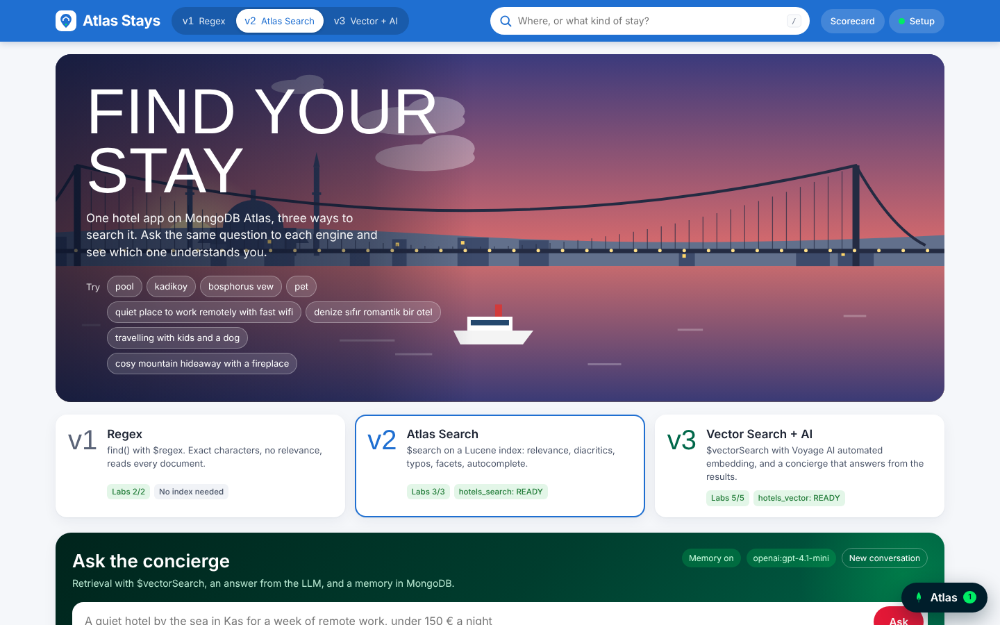

# Atlas Stays

**One hotel app, three generations of search, on MongoDB Atlas.**
Workshop material for MongoDB × İstanbul Java User Group, 17 October 2026.

| | Version | How it searches | What it teaches |
|---|---|---|---|
| **v1** | Regex | `find()` with a case-insensitive `$regex` | What most apps ship first, and where it breaks: diacritics, typos, substrings, no relevance, full collection scans |
| **v2** | Atlas Search | `$search` and `$searchMeta` on a Lucene index | Analyzers (Turkish folding, stemming), boosting, fuzzy matching, autocomplete, highlighting, facets |
| **v3** | Vector Search + AI | `$vectorSearch` with **Voyage AI automated embedding**, then RAG | Search by meaning and across languages with no embedding code, pre-filters, hybrid `$rankFusion`, an LLM concierge with memory in MongoDB |

All three implement one Java interface (`HotelSearch`) and receive the same request. The UI can show them side by side, and the **query ladder** asks eight increasingly human questions to all three and scores the top 5 results of each automatically.



## Quick start (attendees)

You need the Atlas connection string your instructor gave you, and **either** Docker **or** JDK 21+ with Maven 3.9+.

```bash
git clone <repo-url> atlas-stays && cd atlas-stays      # the main branch is the starter
cp .env.example .env                                     # paste MONGODB_URI, set ATTENDEE
```

**With Docker** (nothing else to install):

```bash
docker compose up --build        # http://localhost:8080
docker compose watch             # same, and rebuilds the app every time you save a file in src/
```

**With Maven:**

```bash
mvn -q compile exec:java         # http://localhost:8080
```

On first start the app loads 255 hotels into your own database (`stays_<ATTENDEE>`). Then follow **[LAB.md](LAB.md)**. The **Setup** panel walks you through the exercises in order, one next step at a time, and can write the reference solution into your file when you're stuck.

```bash
mvn test                      # which exercises are done? (no database needed)
git diff main solution -- src/main/java     # the full solution lives on the solution branch
```

There is no local MongoDB in the compose file on purpose: every version, including automated embedding, runs on Atlas.

## What's in the box

```
src/main/java/io/jug/stays/
  App.java                  JDK HttpServer, routes, static files (no framework)
  Config.java               .env / environment variables, one database per attendee
  Bootstrap.java            seeds hotels, creates the chat_history indexes
  SearchIndexes.java        createSearchIndexes / $listSearchIndexes, status for the UI
  Lab.java                  the exercises and their hints
  Ladder.java               the eight ladder questions and how each is scored
  search/
    HotelSearch.java        the interface
    RegexSearch.java        v1   Lab 1
    AtlasTextSearch.java    v2   Lab 2
    SemanticSearch.java     v3   Lab 3
  rag/
    Concierge.java          retrieve, augment, generate, remember   Lab 4
    ChatMemory.java         chat_history in MongoDB                 Lab 4
    Llm.java                OpenAI-compatible or Anthropic, plain HTTP
src/main/resources/
  indexes/hotels_search.json   Atlas Search index definition
  indexes/hotels_vector.json   Vector Search index with "type": "autoEmbed"
  data/hotels.json             255 fictional hotels in real Turkish destinations
  static/                      the UI (vanilla JS, procedural SVG scenery, no build step)
tools/
  generate_hotels.py        regenerates the dataset (deterministic)
  make_starter.py           turns the solution into the starter
scripts/
  provision.sh / cleanup.sh one database user and database per attendee (Atlas CLI)
Dockerfile                  Maven build stage, then a JRE image with the fat jar
compose.yaml                the app (+ a "dryrun" profile that prints the real ladder scorecard)
```

The only runtime dependency is the MongoDB Java driver. Queries are built as plain `Document`s that look exactly like the JSON in the Atlas docs, and the **Atlas Inspector** (bottom right in the UI) shows every pipeline the page just ran.

## Configuration

| Variable | Default | |
|---|---|---|
| `MONGODB_URI` | | Atlas connection string (required) |
| `ATTENDEE` | your OS user | Your database is `stays_<ATTENDEE>` |
| `DB_NAME` | `stays_<ATTENDEE>` | Override the database name |
| `EMBED_MODEL` | `voyage-4` | Model in the automated-embedding index (`voyage-4-lite`, `voyage-4`, `voyage-4-large`) |
| `LLM_API_KEY`, `LLM_BASE_URL`, `LLM_MODEL` | OpenAI, `gpt-4.1-mini` | Any OpenAI-compatible endpoint, including a workshop proxy |
| `ANTHROPIC_API_KEY` | | Use Claude instead (`LLM_PROVIDER=anthropic`) |
| `PORT` | `8080` | With Docker, the port on your machine |
| `RESEED` | `false` | Drop and reload the hotels |
| `AUTO_CREATE_INDEXES` | `false` | Create both search indexes at startup (instructor demo) |
| `LAB_SOLVER` | `true` | The Solve-it buttons in Setup. Set `false` on any public deployment |
| `SOURCE_DIR` | `src/main/java` | Where Solve-it writes solutions (compose sets it to the mounted `./src`) |

Without an LLM key the concierge still retrieves hotels and shows them, without writing an answer.

## Requirements on the Atlas side

* A **dedicated cluster (M10 or larger)**. Free and Flex clusters cap search indexes at 3 and 10 per cluster, and every attendee creates 2.
* **Automated Embedding** (Preview) available in the project, and **storage auto-scaling** turned on, which automated embedding requires on dedicated clusters.
* MongoDB **8.1+** for `$rankFusion`. On older versions, hybrid search falls back to fusing the two lists in Java.

Instructor setup, provisioning and the day-of plan are in **[INSTRUCTOR.md](INSTRUCTOR.md)**.

## Data

Hotel names, prices and reviews are invented. Districts, cities and landmarks are real places in Türkiye. About one description in five is in Turkish, on purpose. Regenerate with `python3 tools/generate_hotels.py`.
